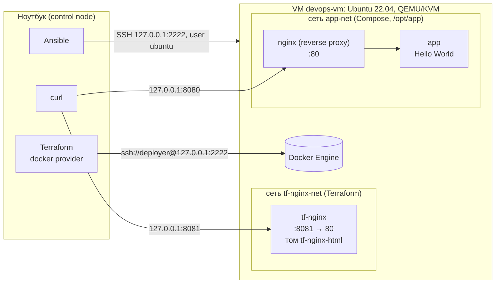
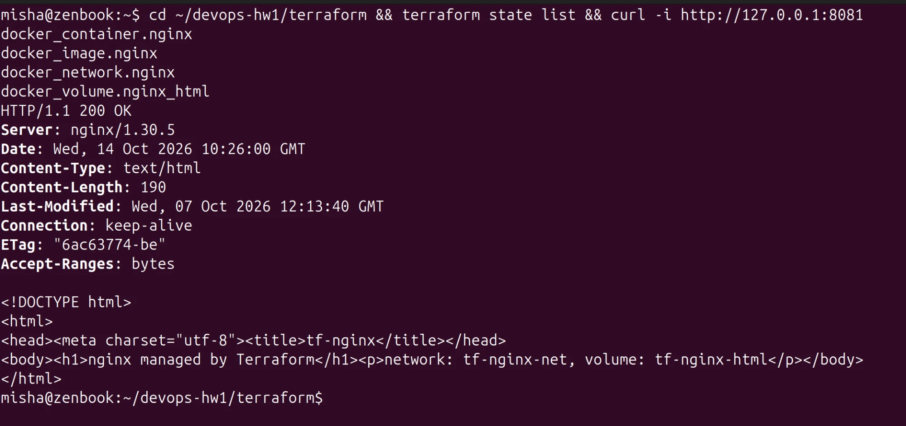
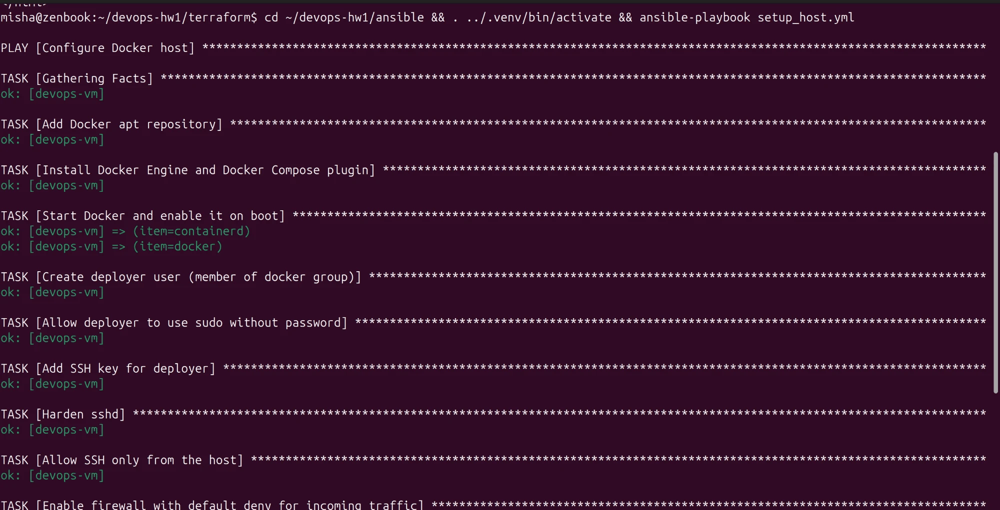
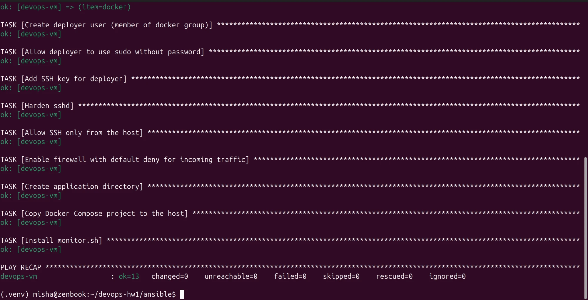
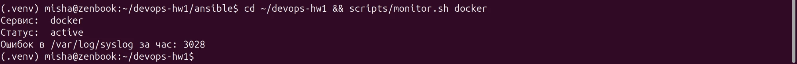
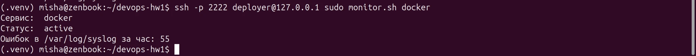
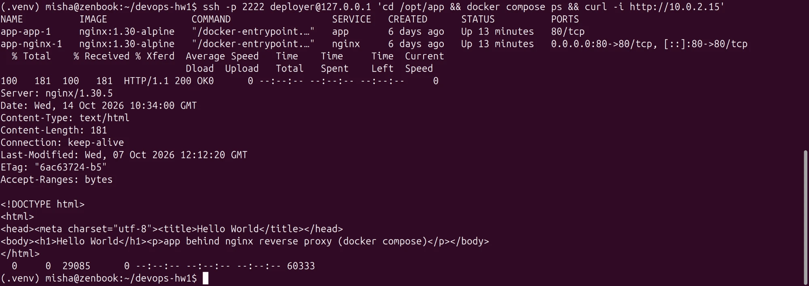

# ДЗ №1 — Фундамент DevOps-инфраструктуры

Воспроизводимая среда под будущее веб-приложение: локальная VM на Ubuntu 22.04,
настройка хоста через **Ansible**, Docker-ресурсы через **Terraform** (провайдер
[kreuzwerker/docker](https://github.com/kreuzwerker/terraform-provider-docker)),
multi-service окружение на **Docker Compose** и Bash-утилита мониторинга.

По дополнению к заданию порядок такой: сначала Ansible (п.3) ставит Docker на хост,
потом Terraform через docker-провайдер создаёт сеть, том и контейнер nginx
на нестандартном порту. Контейнеры Compose работают в своей, отдельной сети.

Этап 2 исходного файла (облачные сеть, VM, Security Group, IAM) по уточнению
преподавателя заменён: Terraform поднимает отдельный nginx со статической страницей
в явно заданной сети, с подключённым томом и не на стандартном порту. С остальной
частью ДЗ этот контейнер не связан.

## Архитектура



VM запущена в сети QEMU user-mode: снаружи она не видна, доступны только
проброшенные порты, и они слушают только `127.0.0.1` хоста.

| Хост (ноутбук)   | VM (IP `10.0.2.15`) | Что это                                  |
|------------------|---------------------|------------------------------------------|
| `127.0.0.1:2222` | `22`                | SSH                                      |
| `127.0.0.1:8080` | `80`                | nginx reverse proxy из Docker Compose    |
| `127.0.0.1:8081` | `8081`              | nginx, созданный Terraform (нестандартный порт) |

## Структура репозитория

```
.
├── ansible/
│   ├── ansible.cfg
│   ├── inventory.ini        # адрес VM
│   └── setup_host.yml       # Docker, deployer, автозапуск, SSH, firewall
├── terraform/
│   ├── versions.tf          # версии terraform/провайдера, provider "docker"
│   ├── variables.tf
│   ├── main.tf              # образ, сеть, том, контейнер nginx
│   ├── outputs.tf
│   └── .terraform.lock.hcl  # зафиксированная версия провайдера
├── compose/                 # Ansible копирует это в /opt/app на VM
│   ├── docker-compose.yml
│   ├── nginx/default.conf   # конфиг reverse proxy
│   └── app/index.html       # Hello World
├── docs/screenshots/        # скриншоты к разделу «Результаты»
├── scripts/
│   ├── vm.sh                # up / down / destroy локальной VM
│   └── monitor.sh           # мониторинг сервиса и syslog
└── requirements.txt         # версия Ansible
```

## Установка и запуск

### 0. Что нужно на ноутбуке

- Linux с KVM (пользователь в группе `kvm`), пакеты `qemu-system-x86 qemu-utils xorriso`
- Terraform ≥ 1.6, Python 3
- SSH-ключ `~/.ssh/id_ed25519` (другой ключ: `SSH_PUBKEY=... scripts/vm.sh up` и пути в `ansible/`)

```bash
python3 -m venv .venv && . .venv/bin/activate
pip install -r requirements.txt
```

### 1. VM

```bash
scripts/vm.sh up      # при первом запуске скачает образ Ubuntu 22.04 (~700 МБ)
```

Скрипт создаёт диск поверх cloud-образа, через cloud-init кладёт ваш публичный ключ
пользователю `ubuntu`, запускает QEMU и ждёт, пока поднимется SSH.

### 2. Настройка хоста — Ansible

```bash
cd ansible
ansible-playbook setup_host.yml   # первый запуск — изменения
ansible-playbook setup_host.yml   # второй запуск — changed=0 (идемпотентность)
```

Playbook:
- подключает официальный apt-репозиторий Docker и ставит `docker-ce`, `containerd.io`,
  `docker-buildx-plugin`, `docker-compose-plugin`;
- включает автозапуск `containerd` и `docker`;
- создаёт `deployer` (группа `docker`, sudo без пароля, вход по вашему ключу);
- запрещает вход под root и по паролю;
- включает UFW: входящие запрещены, SSH — только с адреса хоста;
- копирует `compose/` в `/opt/app` и ставит `monitor.sh` в `/usr/local/bin`.

### 3. Docker-ресурсы — Terraform

```bash
cd terraform
terraform init
terraform plan
terraform apply
terraform state list
curl -i http://127.0.0.1:8081
```

Terraform работает с Docker на VM по SSH под `deployer` и создаёт образ, сеть
`tf-nginx-net`, том `tf-nginx-html` и контейнер `tf-nginx`, который отвечает
на порту 8081. Параметры (порт, имена, образ, адрес Docker) задаются в `variables.tf`.

### 4. Мониторинг — monitor.sh

```bash
scripts/monitor.sh docker                                  # на ноутбуке
ssh -p 2222 deployer@127.0.0.1 sudo monitor.sh docker      # на VM
```

### 5. Docker Compose

```bash
ssh -p 2222 deployer@127.0.0.1
cd /opt/app
docker compose up -d
docker compose ps
curl -i http://$(hostname -I | cut -d' ' -f1)   # curl http://<VM_IP>
```

С ноутбука это же окружение доступно как `curl -i http://127.0.0.1:8080`.

> Используется Compose v2 (`docker compose`, плагин Docker). Отдельный
> `docker-compose` v1 устарел и больше не поддерживается.

### Остановка и удаление

```bash
cd terraform && terraform destroy   # удалить ресурсы Terraform
scripts/vm.sh down                  # выключить VM
scripts/vm.sh destroy               # удалить диск VM (следующий up — с чистого листа)
```

## Результаты

### `terraform state list` и `curl -i` на нестандартный порт



Вывод `terraform apply`:

```
Apply complete! Resources: 4 added, 0 changed, 0 destroyed.

Outputs:

check_command = "curl -i http://127.0.0.1:8081"
container_name = "tf-nginx"
network_name = "tf-nginx-net"
volume_name = "tf-nginx-html"
```

Контейнер подключён только к своей сети, том смонтирован:

```
$ docker inspect tf-nginx ...
networks: tf-nginx-net | mounts: volume:tf-nginx-html->/usr/share/nginx/html | ports: {"80/tcp":[{"HostIp":"0.0.0.0","HostPort":"8081"}]}
```

Повторный `terraform plan -detailed-exitcode` возвращает `0`: реальное состояние совпадает с кодом.

### Ansible: второй запуск (идемпотентность)





Первый запуск на чистой VM: `ok=14 changed=12`.

### monitor.sh

На ноутбуке (Ubuntu 24.04, syslog в формате RFC 3339):



На VM (Ubuntu 22.04, классический формат syslog):



Другие сценарии:

```
$ scripts/monitor.sh nosuch
Сервис 'nosuch' не найден            # код выхода 2

# на VM без sudo syslog не читается — скрипт это сообщает
$ monitor.sh docker
Сервис:  docker
Статус:  active
Ошибок в /var/log/syslog за час: n/a (файла нет или нет прав — попробуйте через sudo)

# на VM
$ sudo systemctl stop cron && sudo monitor.sh cron      # сервис остановлен, код выхода 1
Сервис:  cron
Статус:  inactive
--- journalctl -u cron -n 10 ---
Oct 07 12:08:48 devops-vm systemd[1]: Started Regular background program processing daemon.
Oct 07 12:08:48 devops-vm cron[655]: (CRON) INFO (pidfile fd = 3)
Oct 07 12:08:48 devops-vm cron[655]: (CRON) INFO (Running @reboot jobs)
Oct 07 12:14:15 devops-vm systemd[1]: Stopping Regular background program processing daemon...
Oct 07 12:14:15 devops-vm systemd[1]: cron.service: Deactivated successfully.
Oct 07 12:14:15 devops-vm systemd[1]: Stopped Regular background program processing daemon.
Ошибок в /var/log/syslog за час: 49
```

Число ошибок сверялось вручную: на только что загруженной VM `grep -ciE 'error|fail' /var/log/syslog` дал те же 49, что и скрипт.

### `docker compose ps` и `curl http://<VM_IP>`



Запрос действительно идёт через proxy: в логе `app` клиент — контейнер nginx из `app-net`,
а исходный адрес передан в `X-Forwarded-For`:

```
app-1  | 172.19.0.2 - - [07/Oct/2026:12:15:44 +0000] "GET / HTTP/1.1" 200 181 "-" "curl/8.5.0" "10.0.2.2"
```

### После перезагрузки VM

Docker и все контейнеры поднимаются сами (`enabled` + `restart: unless-stopped`),
каждый в своей сети:

```
$ sudo reboot
...
$ docker ps --format "table {{.Names}}\t{{.Status}}\t{{.Ports}}\t{{.Networks}}"
NAMES         STATUS        PORTS                                 NETWORKS
app-nginx-1   Up 1 second   0.0.0.0:80->80/tcp, [::]:80->80/tcp   app-net
app-app-1     Up 1 second   80/tcp                                app-net
tf-nginx      Up 1 second   0.0.0.0:8081->80/tcp                  tf-nginx-net
```

### Доступ по SSH

```
$ ssh -p 2222 root@127.0.0.1
root@127.0.0.1: Permission denied (publickey).
$ ssh -p 2222 -o PubkeyAuthentication=no deployer@127.0.0.1
deployer@127.0.0.1: Permission denied (publickey).
$ sudo ufw status
Status: active

To                         Action      From
--                         ------      ----
22/tcp                     ALLOW       10.0.2.2
```

## Архитектурные решения

**Локальная VM на QEMU/KVM, а не облако.** Задание разрешает локальный эмулятор.
Скрипт `vm.sh` работает без root: KVM даёт аппаратное ускорение, сеть user-mode не требует
bridge/tap. Ubuntu 22.04 cloud image + cloud-init: SSH-ключ попадает в VM без ручных действий,
а `vm.sh destroy && vm.sh up` даёт чистую машину за минуту — на ней и проверялась
воспроизводимость.

**Terraform — docker-провайдер, Docker на VM по SSH.** Ansible ставит Docker, Terraform
им управляет. Провайдер подключается как `ssh://deployer@...`: доступ к Docker есть только
у владельца SSH-ключа deployer, наружу Docker API не открыт (нет TCP-порта 2375/2376).
- Своя bridge-сеть `tf-nginx-net` — контейнер не в default `bridge` и не в сети Compose.
- Именованный том `tf-nginx-html` в `/usr/share/nginx/html` переживает пересоздание
  контейнера; страница записывается в него через `upload` при создании контейнера.
- Порт 8081 — нестандартный, вынесен в переменную с проверкой диапазона.
- `restart = "unless-stopped"`: контейнер поднимается после перезагрузки VM.
- State — локальный backend (`terraform/terraform.tfstate`). В git не коммитится, а
  `.terraform.lock.hcl` коммитится, чтобы версия провайдера была одинаковой у всех.

**Ansible.** Только идемпотентные модули (`apt`, `user`, `copy`, `ufw`, `deb822_repository`…),
никаких `shell`/`command`, поэтому второй прогон даёт `changed=0`. Sudoers и sshd-конфиг
проверяются перед записью (`visudo -cf`, `sshd -t`) — опечатка не закроет доступ к VM.
Handler перезапускает ssh только при изменении конфига.

**Пользователи и доступ (IAM).** В docker-провайдере нет облачного IAM, поэтому
разграничение доступа сделано на уровне ОС:
- `root` — вход по SSH запрещён;
- `ubuntu` — пользователь cloud-образа, через него Ansible делает первичную настройку;
- `deployer` — рабочий пользователь для Terraform и Compose: вход только по ключу,
  группа `docker`, sudo без пароля (по требованию задания).
  Членство в группе `docker` фактически равно root-доступу на хосте — поэтому вход у
  deployer только по ключу и только с адреса хоста.

**Firewall вместо Security Group.** UFW: входящие запрещены по умолчанию, SSH разрешён
только с `10.0.2.2` — так хост виден из VM в сети QEMU. Порты, опубликованные Docker,
обрабатываются его собственными цепочками iptables в обход UFW. Поэтому наружу
публикуются только нужные порты (80 и 8081), а `app` вообще не публикуется и доступен
только через proxy. Дополнительно QEMU пробрасывает порты только на `127.0.0.1` ноутбука,
так что из локальной сети VM недоступна.

**Compose.** Два сервиса в явной сети `app-net`; proxy обращается к `app` по имени сервиса
через встроенный DNS Docker. Образы зафиксированы на `nginx:1.30-alpine`.

**monitor.sh.** Коды выхода как у плагинов мониторинга: `0` — активен, `1` — не активен,
`2` — ошибка вызова или сервис не найден. Скрипт проверен `shellcheck`.

## Проблемы и решения

| Проблема | Решение |
|---|---|
| `systemctl is-active` для несуществующего сервиса просто печатает `inactive` | Существование проверяется отдельно через `systemctl cat`, иначе — сообщение и код 2 |
| Формат `/var/log/syslog` разный: Ubuntu 22.04 — `Oct  7 14:51:01`, 24.04 — `2026-10-07T14:51:01.48+03:00` | awk разбирает оба формата и сравнивает время в epoch (`mktime`); проверено на gawk и mawk |
| Без root журналы и syslog могут быть недоступны | Скрипт не падает, а пишет, что нужен `sudo`; пустой журнал тоже обрабатывается |
| В ansible-core 2.21 `apt_repository` объявлен устаревшим | Репозиторий Docker подключается через `deb822_repository`, он сам скачивает ключ |
| В sshd действует первое найденное значение параметра, а `50-cloud-init.conf` может задавать `PasswordAuthentication` | Файл назван `00-hardening.conf`, чтобы читаться первым; итог проверен через `sshd -T` |
| Нет root на ноутбуке — нельзя сделать bridge-сеть, IP VM `10.0.2.15` с хоста недоступен | Проброс портов QEMU на `127.0.0.1`; `curl http://<VM_IP>` выполняется на самой VM |
| После пересоздания VM меняется её SSH host key и ssh отказывается подключаться | `vm.sh` удаляет старую запись из `known_hosts` и принимает новый ключ при первом подключении |
| Docker обходит UFW для опубликованных портов | Публикуется только необходимое, порты QEMU слушают только `127.0.0.1` (см. выше) |

## Вопросы для самопроверки

1. **Императивный vs декларативный.** Bash — последовательность команд «как сделать».
   Terraform описывает желаемое состояние «что должно быть», сам строит план изменений
   и применяет только разницу. Ansible-модули тоже описывают состояние
   (`state: present`), но выполняются по шагам в заданном порядке.
2. **Зачем state.** State связывает ресурсы из кода с реальными объектами (id контейнера,
   сети, тома). По нему Terraform считает diff и знает, что удалять. Если удалить state,
   Terraform «забудет» ресурсы: `plan` предложит создать их заново, а `apply` упадёт на
   конфликте имён (`tf-nginx` уже существует). Восстанавливается через `terraform import`.
3. **Идемпотентность.** Повторное применение не меняет систему. Каждый модуль Ansible
   сначала проверяет текущее состояние и вносит изменения только при расхождении.
   Проверено вторым запуском: `changed=0`.
4. **Сервис не найден / лог пуст.** Нет сервиса — сообщение и код 2. Пустой журнал
   (или нет прав) — «журнал пуст или нет прав». Syslog недоступен — `n/a` с подсказкой про `sudo`.
5. **Firewall.** Default deny на входящие, SSH только с одного адреса, только по ключу,
   без root. Исключены перебор паролей, вход под root и доступ к VM из сети. Порты QEMU
   слушают только `127.0.0.1`, Docker API наружу не открыт.

## Git workflow

- `main` — стабильная ветка, работа в `feature/infra-setup`;
- изменения попадают в `main` через Merge/Pull Request с ревью;
- после мержа — тег `v0.1.0`.
