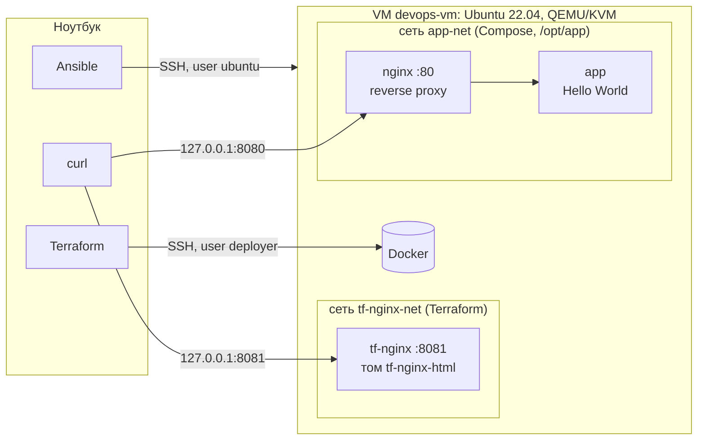

# ДЗ №1. Фундамент DevOps-инфраструктуры

Локальная VM на Ubuntu 22.04, настройка хоста через **Ansible**, nginx через **Terraform**
(провайдер [kreuzwerker/docker](https://github.com/kreuzwerker/terraform-provider-docker)),
окружение на **Docker Compose** и Bash-скрипт мониторинга.

Порядок по дополнению к заданию: сначала Ansible (Этап 3) ставит Docker на VM, потом
Terraform через docker-провайдер поднимает nginx со статической страницей в отдельной
сети, с подключённым томом и на нестандартном порту. Этап 2 исходного файла (облачные
сеть, VM, Security Group, IAM) по уточнению преподавателя не выполняется.
Контейнеры Compose работают в своей сети.

## Архитектура



VM работает в сети QEMU user-mode. С ноутбука доступны только проброшенные порты,
и только на `127.0.0.1`:

| Ноутбук          | VM (IP `10.0.2.15`) | Что это                        |
|------------------|---------------------|--------------------------------|
| `127.0.0.1:2222` | `22`                | SSH                            |
| `127.0.0.1:8080` | `80`                | nginx из Docker Compose        |
| `127.0.0.1:8081` | `8081`              | nginx, созданный Terraform     |

## Структура репозитория

```
.
├── ansible/
│   ├── ansible.cfg
│   ├── inventory.ini        # адрес VM
│   └── setup_host.yml       # Docker, deployer, автозапуск, SSH
├── terraform/
│   ├── versions.tf          # версии terraform и провайдера, provider "docker"
│   ├── variables.tf
│   ├── main.tf              # образ, сеть, том, контейнер nginx
│   ├── outputs.tf
│   └── .terraform.lock.hcl
├── compose/                 # Ansible копирует в /opt/app на VM
│   ├── docker-compose.yml
│   ├── nginx/default.conf   # конфиг reverse proxy
│   └── app/index.html
├── docs/screenshots/
├── scripts/
│   ├── vm.sh                # up / down / destroy для VM
│   └── monitor.sh
└── requirements.txt         # версия Ansible
```

## Запуск

### 0. Что нужно на ноутбуке

- Linux с KVM, пакеты `qemu-system-x86 qemu-utils xorriso`
- Terraform >= 1.6, Python 3
- SSH-ключ `~/.ssh/id_ed25519`

```bash
python3 -m venv .venv && . .venv/bin/activate
pip install -r requirements.txt
```

### 1. VM

```bash
scripts/vm.sh up      # при первом запуске скачает образ Ubuntu 22.04 (~700 МБ)
```

Скрипт создаёт диск поверх cloud-образа, через cloud-init кладёт публичный ключ
пользователю `ubuntu`, запускает QEMU и ждёт, пока поднимется SSH.

### 2. Ansible

```bash
cd ansible
ansible-playbook setup_host.yml   # первый запуск
ansible-playbook setup_host.yml   # второй запуск: changed=0
```

Playbook:
- подключает apt-репозиторий Docker и ставит `docker-ce`, `containerd.io`,
  `docker-buildx-plugin`, `docker-compose-plugin`;
- включает автозапуск `containerd` и `docker`;
- создаёт пользователя `deployer`: группа `docker`, sudo без пароля, вход по ключу;
- запрещает вход по SSH под root и по паролю;
- копирует `compose/` в `/opt/app` и `monitor.sh` в `/usr/local/bin`.

### 3. Terraform

```bash
cd terraform
terraform init
terraform plan
terraform apply
terraform state list
curl -i http://127.0.0.1:8081
```

Создаются образ nginx, сеть `tf-nginx-net`, том `tf-nginx-html` и контейнер `tf-nginx`
на порту 8081. Terraform подключается к Docker на VM по SSH под `deployer`.

### 4. monitor.sh

```bash
scripts/monitor.sh docker                                  # на ноутбуке
ssh -p 2222 deployer@127.0.0.1 sudo monitor.sh docker      # на VM
```

### 5. Docker Compose

```bash
ssh -p 2222 deployer@127.0.0.1
cd /opt/app
docker compose up -d
docker compose ps
curl -i http://$(hostname -I | cut -d' ' -f1)   # curl http://<VM_IP>
```

С ноутбука: `curl -i http://127.0.0.1:8080`. Используется Compose v2 (`docker compose`),
старый `docker-compose` v1 больше не поддерживается.

### Остановка

```bash
cd terraform && terraform destroy
scripts/vm.sh down       # выключить VM
scripts/vm.sh destroy    # удалить диск VM, следующий up начнёт с чистой машины
```

## Результаты

### `terraform state list` и `curl -i` на порт 8081


Контейнер подключён только к своей сети, том смонтирован:

```
$ docker inspect tf-nginx ...
networks: tf-nginx-net | mounts: volume:tf-nginx-html->/usr/share/nginx/html
```

### Ansible: второй запуск


Первый запуск на чистой VM: `ok=12 changed=10`, второй: `ok=11 changed=0`.

### monitor.sh

На ноутбуке (Ubuntu 24.04):


На VM (Ubuntu 22.04):


Обработка ошибок:

```
$ scripts/monitor.sh nosuch
Сервис 'nosuch' не найден                      # код выхода 2

$ monitor.sh docker                            # на VM без sudo
Сервис:  docker
Статус:  active
Ошибок в /var/log/syslog за час: n/a (файла нет или нет прав — попробуйте через sudo)

$ sudo systemctl stop cron && sudo monitor.sh cron    # код выхода 1
Сервис:  cron
Статус:  inactive
--- journalctl -u cron -n 10 ---
Oct 07 12:08:48 devops-vm systemd[1]: Started Regular background program processing daemon.
Oct 07 12:08:48 devops-vm cron[655]: (CRON) INFO (pidfile fd = 3)
Oct 07 12:08:48 devops-vm cron[655]: (CRON) INFO (Running @reboot jobs)
Oct 07 12:14:15 devops-vm systemd[1]: Stopping Regular background program processing daemon...
Oct 07 12:14:15 devops-vm systemd[1]: cron.service: Deactivated successfully.
Oct 07 12:14:15 devops-vm systemd[1]: Stopped Regular background program processing daemon.
Ошибок в /var/log/syslog за час: 49
```

Число ошибок проверял вручную: на только что загруженной VM
`grep -ciE 'error|fail' /var/log/syslog` дал те же 49.

### `docker compose ps` и `curl http://<VM_IP>`


Запрос идёт через proxy: в логе `app` клиентом указан контейнер nginx из `app-net`,
исходный адрес передан в `X-Forwarded-For`:

```
app-1  | 172.19.0.2 - - [07/Oct/2026:12:15:44 +0000] "GET / HTTP/1.1" 200 181 "-" "curl/8.5.0" "10.0.2.2"
```

### После перезагрузки VM

```
$ sudo reboot
...
$ docker ps --format "table {{.Names}}\t{{.Status}}\t{{.Networks}}"
NAMES         STATUS        NETWORKS
app-nginx-1   Up 1 second   app-net
app-app-1     Up 1 second   app-net
tf-nginx      Up 1 second   tf-nginx-net
```

### Доступ по SSH

```
$ ssh -p 2222 root@127.0.0.1
root@127.0.0.1: Permission denied (publickey).
$ ssh -p 2222 -o PubkeyAuthentication=no deployer@127.0.0.1
deployer@127.0.0.1: Permission denied (publickey).
```

## Архитектурные решения

**VM на QEMU/KVM.** Задание разрешает локальный эмулятор. `vm.sh` работает без root:
KVM ускоряет VM, сети user-mode не нужны bridge и tap. Ключ попадает в VM через cloud-init,
а `vm.sh destroy && vm.sh up` даёт чистую машину примерно за минуту. На такой машине
и проверялась воспроизводимость.

**Ansible.** Используются только модули, которые сами проверяют текущее состояние
(`apt`, `user`, `copy`, `file`, `authorized_key`, `deb822_repository`, `systemd_service`), без
`shell`/`command`, поэтому второй запуск даёт `changed=0`. Файлы sudoers и sshd
проверяются до записи (`visudo -cf`, `sshd -t`), чтобы ошибка в конфиге не закрыла
доступ к VM.

**Terraform.**
- Своя bridge-сеть `tf-nginx-net`: контейнер не попадает ни в стандартную сеть `bridge`,
  ни в сеть Compose.
- Именованный том `tf-nginx-html` смонтирован в `/usr/share/nginx/html` и сохраняется при
  пересоздании контейнера. Страница записывается в него блоком `upload`.
- Порт 8081 вынесен в переменную. `restart = "unless-stopped"` поднимает контейнер после
  перезагрузки VM.
- Состояние хранится локально в `terraform/terraform.tfstate` и в git не попадает.
  `.terraform.lock.hcl` закоммичен, чтобы у всех была одна версия провайдера.

**Пользователи.**
- `root`: вход по SSH запрещён.
- `ubuntu`: пользователь cloud-образа, через него Ansible делает первичную настройку.
- `deployer`: рабочий пользователь для Terraform и Compose. Вход только по ключу,
  группа `docker`, sudo без пароля (по заданию).

**Compose.** Два сервиса в сети `app-net`, proxy обращается к `app` по имени сервиса.
У `app` порт наружу не опубликован, он доступен только через proxy.

**monitor.sh.** Коды выхода: `0` — сервис активен, `1` — не активен, `2` — ошибка
вызова или сервис не найден. Скрипт проверен `shellcheck`.

## Проблемы и решения

| Проблема | Решение |
|---|---|
| `systemctl is-active` для несуществующего сервиса печатает `inactive` | Существование проверяется отдельно через `systemctl cat` |
| Формат `/var/log/syslog` разный: в Ubuntu 22.04 `Oct  7 14:51:01`, в 24.04 `2026-10-07T14:51:01+03:00` | awk разбирает оба формата и сравнивает время через `mktime` |
| Без root журналы и syslog могут быть недоступны | Скрипт не падает, а подсказывает запустить через `sudo` |
| В ansible-core 2.21 `apt_repository` помечен устаревшим | Репозиторий подключается через `deb822_repository` |
| sshd берёт первое найденное значение параметра, а `50-cloud-init.conf` может задать `PasswordAuthentication` | Файл назван `00-hardening.conf`, чтобы читаться первым |
| Без root на ноутбуке нельзя сделать bridge-сеть, IP VM `10.0.2.15` с ноутбука недоступен | Проброс портов QEMU на `127.0.0.1`, `curl http://<VM_IP>` выполняется на самой VM |
| После пересоздания VM меняется её SSH host key | `vm.sh` удаляет старую запись из `known_hosts` |

## Git workflow

- работа ведётся в отдельных ветках, в `main` изменения попадают через Pull Request с ревью;
- `feature/infra-setup`: основная работа, после мержа тег `v0.1.0`;
- `cleanup`: удалён UFW и упрощены Terraform и README, после мержа тег `v0.1.1`.
